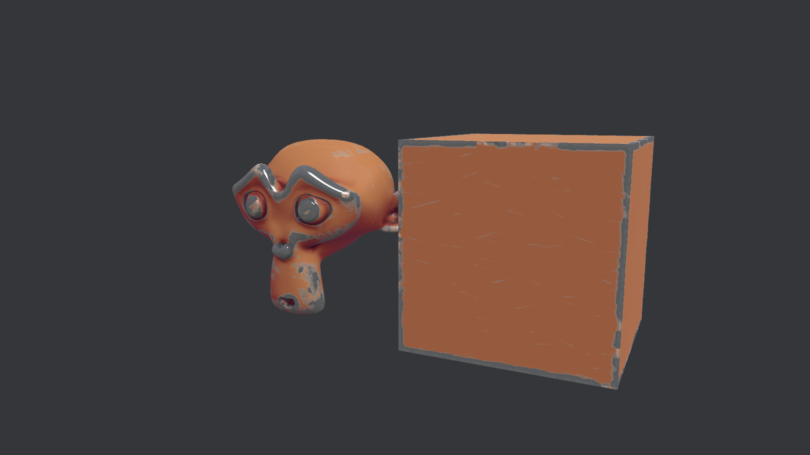
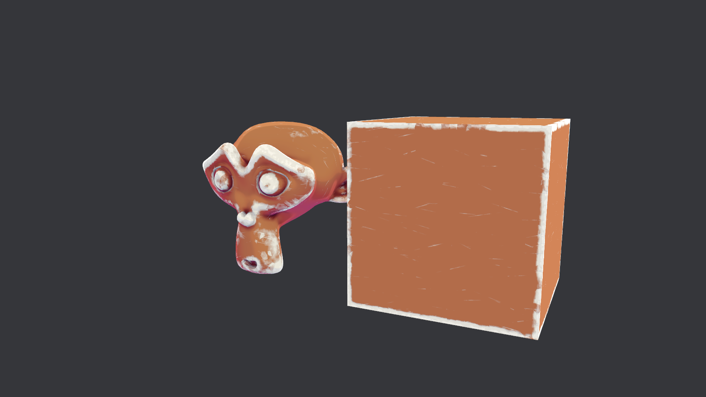
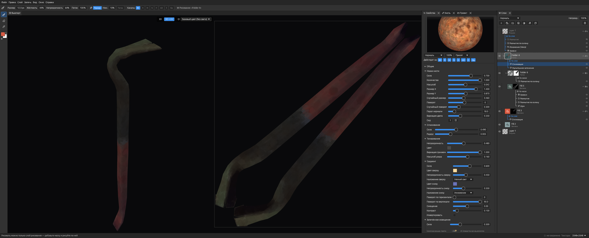
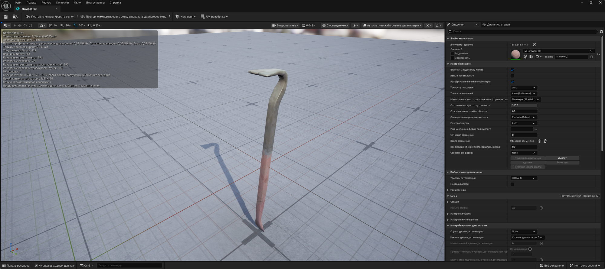
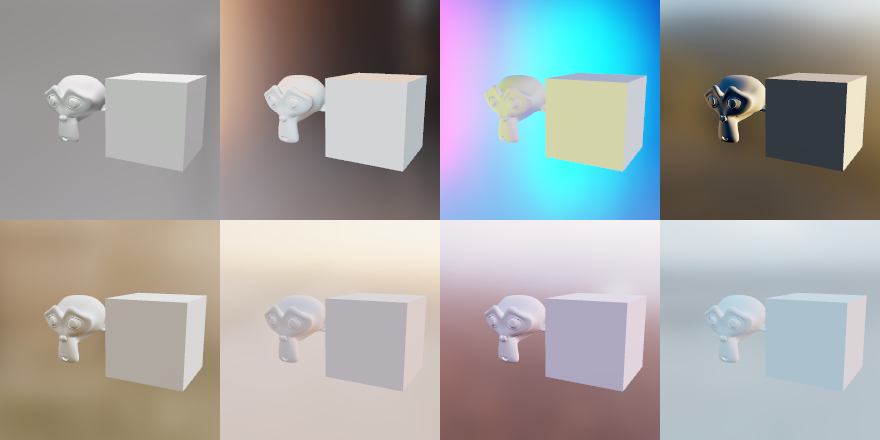
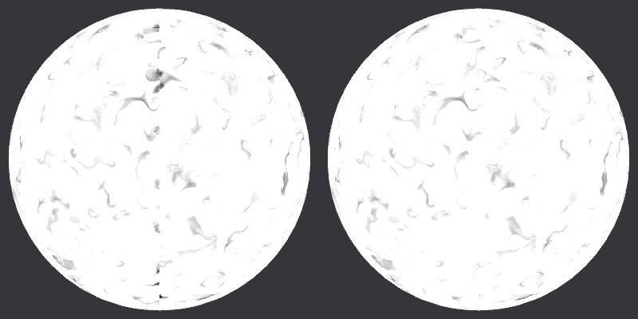

# Stylized3DPaint

[](https://boosty.to/nosleeproom)
[](https://github.com/NotsleepSXS/stylized3dpaint/releases)

Open-source 3D texture painter focused on stylized / hand-painted texturing.
Written in Rust with wgpu and egui.

**Status:** 0.1 — first public version, early but usable. Built for Linux on Wayland (native, incl. pen tablets); it also starts on X11 through winit, without pen pressure. A Windows build (installer) is provided but less tested; macOS is untested.

| Lit | Toon |
|-----|------|
|  |  |

*Test model with a Stylized bake and an effect stack: metal edge wear, edge highlight, cavity
darken, hue shift by light — no hand painting.*

### In use on a real model



*A real asset being textured: the viewport in 3D + UV mode, the Stylization filter's settings
with its preview on a sample shape, and a layer stack of fills, folders, masks and effects.*

### In a game engine



*A crowbar textured in Stylized3DPaint, exported and opened in Unreal Engine 5's static mesh editor.*

## HDRI lighting

The viewport's **Material (Lit)** mode is lit by an HDRI: diffuse light from spherical harmonics,
reflections from a GGX-prefiltered environment (sharper on glossy, blurrier on rough surfaces),
ACES tone mapping and auto exposure so every map has a similar brightness.



- **8 built-in maps** from [Poly Haven](https://polyhaven.com/hdris) (CC0), embedded at 1K:
  two Ferndale studios, Studio Kominka, Camdeboo Road, Cobblestone Parish Road, Minedump Flats,
  Qwantani Dusk 2, Sunset in the Chalk Quarry ([details](assets/hdri/LICENSE.md)).
- **Your own HDRIs**: *Environment* panel (sun icon in the viewport) → *Choose folder…*; `.hdr` / `.exr`
  equirectangular maps. A file named like a built-in (e.g. `camdeboo_road_2k.hdr`) replaces it, so
  you can drop in higher-resolution versions.
- **Rotate** the lighting with the slider or **Shift + right-drag** in the viewport; exposure (EV),
  auto exposure, and the HDRI as a (blurred) background.
- Maps are prepared in the background (~2 s for a 2K map) and the choice is remembered.

## Download

Get the latest version from **[Releases](https://github.com/NotsleepSXS/stylized3dpaint/releases)**:

- **Linux (x86_64):** `Stylized3DPaint-<version>-linux-x86_64.tar.gz` — unpack and run `./install.sh`
  (installs for your user: app menu entry, `stylized3dpaint` command, `.s3dp` file type; `./uninstall.sh`
  removes it), or just run `./stylized3dpaint`.
- **Windows (x64):** `Stylized3DPaint-<version>-windows-x64-setup.exe` installer, or the portable `.zip`.

## Support the project

Stylized3DPaint is free and open source. If it is useful to you, you can support its development on
**[Boosty](https://boosty.to/nosleeproom)** ❤ — the link is also in the app under *Help*.

## Build

Needs a recent stable Rust (edition 2024) and a Vulkan / Metal / DX12 capable GPU.

```sh
git clone https://github.com/NotsleepSXS/stylized3dpaint
cd stylized3dpaint
cargo run --release -- path/to/model.fbx
```

Supported model formats: glTF/GLB, FBX, OBJ.

## Controls

| Action | Input |
|--------|-------|
| Paint / erase / eyedropper | B / E / I, then LMB |
| Brush size | [ and ] |
| Swap / default colors | X / D |
| Orbit | Alt+LMB or MMB |
| Pan | RMB, Alt+MMB or Shift+MMB |
| Zoom | Wheel or Alt+RMB |
| Frame model | F |
| Viewport mode | F1–F9 (Lit, Toon, Unlit, UV, Normals, Roughness, Metallic, Height, Emissive) |
| Undo / redo | Ctrl+Z / Ctrl+Shift+Z |
| New layer / duplicate / delete | Ctrl+Shift+N / Ctrl+J / Del |
| New / open / save / export | Ctrl+N / Ctrl+O / Ctrl+S / Ctrl+Shift+E |
| Bake mesh maps | Ctrl+B |
| Viewport: 3D / 3D + UV | U |
| Rotate the HDRI lighting | Shift + right-drag |
| Pen (Wayland) | tip paints with pressure, eraser end erases, lower button orbits, upper button = RMB |

## Features

- Texture-space painting with occlusion test and seam-free UV borders
- Layer stack shared by all texture sets: paint and fill layers, masks, 18 Photoshop blend modes, opacity
- Channels: Base Color, Roughness, Metallic, Height (shown as bump), Emissive
- Eyedropper picks the whole material under the cursor
- GPU ray-traced baking (BVH + compute shaders), with or without a high-poly source.
  *Stylized* mode bakes wide soft edge / cavity masks, painterly AO, a sky light with soft
  shadows and geometry-aware smoothing — maps meant to be layered for hand-painted looks
- Mask effect stacks: generators from baked maps, height gradients and seamless 3D noise
  (Perlin, Cellular, brush Strokes), filters **Warp**, **Slope Blur**, **Directional**, Blur, Levels
- **Stylize** filter layer: painterly simplification, value bands, warm lights / cool shadows,
  edge highlights, cavity darkening, simplified roughness, crisp metal, beveled height
- Smart layers: Edge highlight, Cavity dirt, Top light, Bottom shadow
- Declarative effect engine (JSON + WGSL per effect, UI generated from the definition):
  wear (metal / wood edge wear, paint peel, rust, scratches, stone chips, wood grain) and
  stylization (Stylization master filter, toon shading, posterize, palette lock, gradient map,
  edge highlight, cavity darken, hue shift by light), each with Light / Medium / Strong / Stylized presets
- Layer tree with folders, effect layers, anchors and per-channel blending
- **Seamless (3D) mode** for every effect that reads neighbouring texels (blur, warp, slope blur, edge wear, AO, curvature, Stylization…): lookups continue across UV seams through precomputed seam links (on by default)

  
- **HDRI lighting** (image-based: SH diffuse + GGX-prefiltered reflections, ACES tone mapping, auto exposure): 8 built-in Poly Haven maps, your own `.hdr` / `.exr` folder, rotation (also Shift + right-drag), exposure, optional blurred background
- **Native Wayland pen tablet** support (`zwp_tablet_v2`): pressure → size / flow, eraser end, barrel buttons
- `.s3dp` project files (zip: mesh + layer PNGs + baked maps + JSON)
- Export presets: Unreal (ORM / separate), Unity URP / HDRP, Godot, glTF, Stylized Unlit,
  Spec/Gloss, Sketchfab — channel packing, padding, DirectX / OpenGL normals, PNG / TGA / TIFF / EXR / JPG
- Russian and English UI

## Independent, clean-room development

Stylized3DPaint is an **independent implementation**. It was written from scratch with the
clean-room approach: **no source code, binaries, shaders, presets or other assets of Adobe
Substance 3D Painter (or any other proprietary texturing tool) were used, decompiled or
examined**. Only general, publicly known texturing concepts (layers, masks, mesh-map baking,
PBR channels) were reimplemented, and the design was built from the start around the needs of
**stylized / hand-painted** texturing rather than as a copy of an existing product.

Substance 3D Painter is a trademark of Adobe; it is mentioned only for comparison.
This project is not affiliated with or endorsed by Adobe.

## Credits

Blend-mode formulas and the dark UI palette are adapted from
[PhotoCraft](https://github.com/storytold/photocraft) (MIT OR Apache-2.0); the tablet input
design follows its `photocraft-tablet` notes.
Icons: [Phosphor](https://phosphoricons.com) via `egui-phosphor` (MIT).
Built-in HDRIs: [Poly Haven](https://polyhaven.com) (CC0), see [assets/hdri/LICENSE.md](assets/hdri/LICENSE.md).

## Roadmap

- **M0** – window, model import, orbit camera, clay/UV/normal shading ✅
- **M1** – brush painting on the mesh (texture-space projection, seam dilation, undo, PNG export) ✅
- **M2** – layers, masks, Photoshop blend modes, material channels, eyedropper, `.s3dp` project files, Photoshop-style UI ✅
- **M3** – GPU mesh map baking from the mesh itself or a high-poly: AO, curvature, edges, cavity, thickness, sky light, normal, world normal, position; Realistic and Stylized modes ✅
- **M4** – mask generators (baked maps, height gradient, 3D noise), Warp / Slope Blur / Directional filters, Stylize filter layer, smart layers, Toon viewport ✅
- **M5** – effect engine, layer tree, wear / stylize effects, export presets ✅
- **M6** – native Wayland pen pressure ✅
- Next: brush textures and pen tilt, release builds

Known issues: [KNOWN_ISSUES.md](KNOWN_ISSUES.md).

## License

Dual-licensed under [MIT](LICENSE-MIT) or [Apache-2.0](LICENSE-APACHE), at your option.
